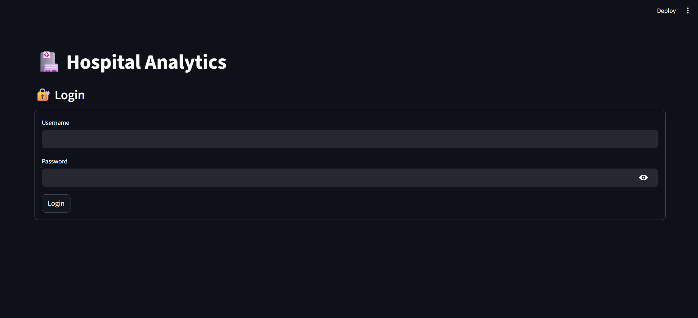
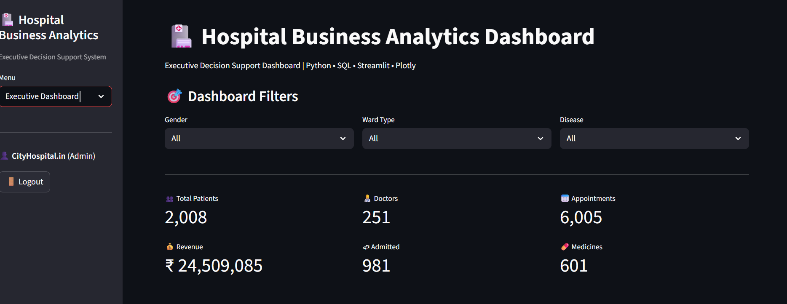
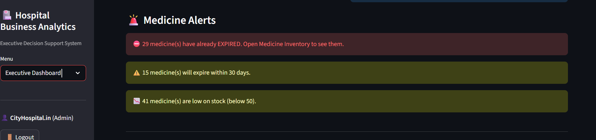

# 🏥 Hospital Analytics Dashboard

An interactive Hospital Management and Analytics Dashboard built with **Python, Streamlit, MySQL / TiDB, Pandas and Plotly**. It helps hospitals and clinics manage patients, doctors, appointments, billing and medicine inventory, and gives administrators a live analytics dashboard of key business metrics.

## 🔗 Live Demo

**👉 https://hospital-analytics-dashboard-01.streamlit.app/**

> The app runs on free hosting, so it may take a minute to wake up on the first visit.
> The demo contains **fake data only**. Please do not enter real patient information.
> Demo login (Receptionist / Doctor): ask the author for the credentials.

---

## 📊 Dashboard Preview

| Admin login | Dashboard |
| --- | --- |
|  |   | 

 | Medicine Alerts |  Pending Bills |
| --- | --- |
  |  |

---

## 🚀 Features

- 🔐 **Secure login** with role-based access (Admin / Doctor / Receptionist)
- 🔑 **User management** page for Admin (add and remove staff accounts)
- 📊 Executive dashboard with live KPIs, filters (gender, ward, disease) and alerts
- 🔍 **Search** for patients and records
- 🧑 Patient management (add, view, delete with confirmation, CSV export)
- 👨‍⚕️ Doctor management
- 📅 Appointment booking and tracking
- 💰 Billing and revenue analysis (paid / pending / partial)
- 🧾 **PDF bill generation and download**
- ⏳ **Pending Bills** page to track unpaid and partially paid bills
- 💊 Medicine inventory management
- ⏰ **Medicine alerts** for low stock and expiry
- 🦠 Disease, ward occupancy, age group and gender analytics
- 📥 CSV download on every data table

---

## 🔐 Roles

| Role | Access |
| --- | --- |
| Admin | Everything, including delete patient and Manage Users |
| Doctor | Dashboard, view patients, doctors and appointments |
| Receptionist | Add patient, book appointment, billing, medicine, view pages |

Passwords are stored as salted PBKDF2 hashes, never as plain text. On first run the app asks you to create the Admin account, so there is no default password.

---

## 🛠️ Technologies Used

| Technology | Purpose |
| --- | --- |
| Python | Application logic |
| Streamlit | Web interface |
| MySQL (local) / TiDB Cloud (live demo) | Database |
| PyMySQL | Database connection |
| Pandas | Data processing |
| Plotly | Interactive charts |
| fpdf2 | PDF bill generation |
| Streamlit Community Cloud | Hosting |

---

## ⚙️ Installation

**1. Clone the repository**
```bash
git clone https://github.com/basharux/Hospital-Analytics-Dashboard.git
cd Hospital-Analytics-Dashboard
```

**2. Install dependencies**
```bash
pip install -r requirements.txt
```

**3. Create the MySQL database**

Create a database named `hospital_db` with these tables:

- `patients` (patient_id, name, age, gender, phone, disease, room_no, ward_type, admit_status)
- `doctors` (doctor_id, name, specialization, fees, room_no)
- `appointments` (appointment_id, patient_id, doctor_id, date, status)
- `billing` (bill_id, patient_id, amount, payment_status)
- `medicines` (medicine_id, medicine_name, quantity, price, expiry_date, supplier)

The `users` table for login is created automatically on first run.

**4. Add your database credentials**

Create a file `.streamlit/secrets.toml` (this file is git-ignored and is never uploaded):

```toml
DB_HOST = "localhost"
DB_USER = "root"
DB_PASSWORD = "your_mysql_password"
DB_NAME = "hospital_db"
```

---

## ▶️ How to Run

```bash
python -m streamlit run hospitall.py
```

On the first run, create the Admin account on the setup screen, then log in.

---

## 📂 Project Structure

```
Hospital-Analytics-Dashboard/
│
├── hospitall.py        # Main Streamlit application
├── auth.py             # Login, roles and user management
├── requirements.txt    # Python dependencies
├── .gitignore          # Keeps secrets out of GitHub
├── screenshots/        # README screenshots
└── README.md
```

---

## 🔒 Security Note

This is a demo / learning project. Before using it with real patient data, use a separate database, regular backups and proper privacy controls.

---

## 📈 Future Improvements

- 📧 Email / SMS notifications for pending bills
- 🧾 Prescription and patient history
- 💾 Automatic database backups
- 📱 Mobile responsive design

---

## 👨‍💻 Author

**Bashar Hayat**, Aspiring Data Analyst

Skills: SQL, Python, Power BI, Excel, Pandas, Streamlit, Plotly

---

⭐ If you like this project, don't forget to star the repository!
