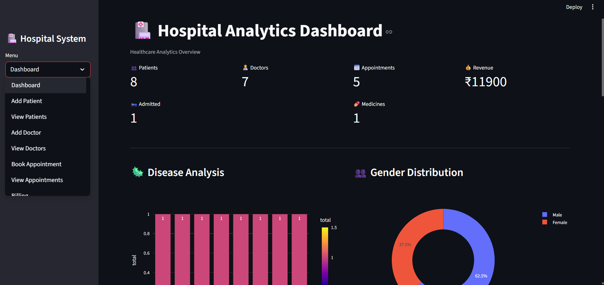

# 🏥 Hospital Analytics Dashboard

An interactive Hospital Analytics Dashboard built using **Python, Streamlit, SQLite, Pandas, and Plotly**. This project helps hospitals monitor patient records, doctor performance, appointments, medicine inventory, and revenue through interactive visualizations.

---

# 📌 Project Overview

The Hospital Analytics Dashboard is designed to simplify hospital management and data analysis. It provides administrators with a centralized dashboard to monitor key hospital metrics, manage patient and doctor records, analyze disease trends, and track revenue.

This project demonstrates skills in **Python, SQL, Data Analysis, Data Visualization, and Dashboard Development**.

---

# 🚀 Features

- 📊 Interactive Analytics Dashboard
- 👨‍⚕️ Doctor Management
- 🧑 Patient Management
- 📅 Appointment Booking & Tracking
- 💰 Billing & Revenue Analysis
- 💊 Medicine Inventory Management
- 🦠 Disease Analysis
- 👥 Gender Distribution Analysis
- 🛏️ Bed Occupancy Tracking
- 📈 Real-time KPIs
- 🔍 Easy-to-use Interface

---

# 🛠️ Technologies Used

| Technology | Purpose |
|------------|---------|
| Python | Backend Development |
| Streamlit | Web Application |
| SQLite | Database |
| Pandas | Data Processing |
| Plotly | Interactive Charts |
| SQL | Database Queries |

---

# 📊 Dashboard Preview



---

# ⚙️ Installation

### Clone the Repository

```bash
git clone https://github.com/YOUR_USERNAME/Hospital-Analytics-Dashboard.git
```

### Navigate to the Project

```bash
cd Hospital-Analytics-Dashboard
```

### Install Dependencies

```bash
pip install -r requirements.txt
```

---

# ▶️ How to Run

Run the Streamlit application:

```bash
streamlit run hospitall.py
```

The application will open automatically in your browser.

---

# 📈 Dashboard KPIs

- Total Patients
- Total Doctors
- Total Appointments
- Total Revenue
- Admitted Patients
- Medicine Inventory

---

# 📊 Visualizations

- Disease Analysis
- Gender Distribution
- Revenue Analytics
- Appointment Analytics
- Patient Statistics

---

# 📂 Project Structure

```
Hospital-Analytics-Dashboard/
│
├── hospital.py
├── hospital_db
├── requirements.txt
├── dashboard.png.png
└── README.md
```

---

# 📈 Future Improvements

- 🔐 User Authentication
- 👥 Role-Based Login (Admin/Doctor/Receptionist)
- ☁️ MySQL/PostgreSQL Support
- 📄 PDF Report Generation
- 📧 Email Notifications
- 📱 Mobile Responsive Design
- ☁️ Cloud Deployment
- 📊 Advanced Analytics Dashboard

---

# 👨‍💻 Author

**Bashar Hayat**

Aspiring Data Analyst

### Skills

- SQL
- Python
- Power BI
- Excel
- Pandas
- Streamlit
- Plotly

---

⭐ If you like this project, don't forget to Star the repository!
